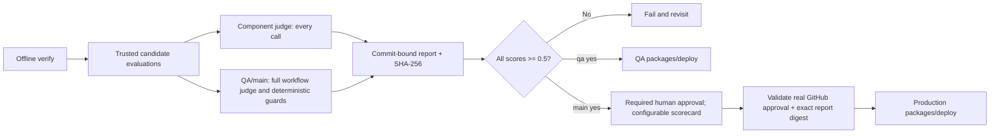

# Editorial agent evaluations and release gates

The CI harness executes the actual CrewAI builder and configured model routing against synthetic public research. It evaluates every observed visible LLM completion, including format retries. The independent model judge scores relevance, faithfulness and task completion from 0 to 1. No averaging can hide a failing call or dimension.

| Branch/event | Evaluation | Publishing/deployment |
| --- | --- | --- |
| `dev` push | Component scores for each role/call | Validation only; no dev infrastructure is introduced |
| `qa` push | Full trajectory plus every role/call | QA package/deploy requires all scores >= **0.5** |
| `main` push | Component and trajectory suites, then human review | Production packages and deployment wait for a recorded review of the exact commit/report |
| Pull request | Existing offline checks and new harness regressions | No provider/deployment secrets and no publishing |
| Explicit infrastructure-only/import-state | Existing infrastructure checks | Existing recovery path; skips application publishing and agent generation/evaluations |

Every relevant score must be at least 0.5; exactly 0.5 passes. Missing roles, unknown components/tools, malformed scores, failed model/judge requests, missing visible structured completions or critical guard failures fail closed. Revise the prompt, application or evaluation harness based on the report, then retest. CI does not rewrite prompts, clear blockers or force agent approval.



## Inventory and observed evidence

`evals/cases.json` explicitly registers 22 role/flow components across these paths:

| Flow | Required role order |
| --- | --- |
| Scheduled article/Facebook | product_owner → business_analyst → researcher → creative → writer → engineering → editor → tester → delivery |
| Manual campaign | product_owner → business_analyst → researcher → creative → writer → engineering → tester → editor → delivery |
| Social-only | researcher → writer → editor → delivery |

Dev component evaluation executes each actual crew with its own prompts/dependencies and scores each completion against the role instructions and human-authored synthetic facts. It keeps upstream dependencies intact rather than substituting a different generic prompt. Adding a role or model call requires updating the inventory and meaningful references. `build_crew(..., evaluation_observer=...)` is opt-in; production behavior is unchanged when it is absent.

QA runs `main.execute_run` with a fresh temporary SQLite store and the actual scheduled/manual/social application code. The report uses actual task/agent/run events. It checks observed role order, schema-valid completions, independent Editor/Tester approvals where present, unresolved blockers, private drafts, and manual approval behavior. The full-trajectory judge sees visible role outputs and safe event labels, so it can assess grounding and semantic handoff consistency beyond the final artifact.

For scheduled publishing, the actual approved-content hashing, citation allowlist, reviewer checks, publication window and committed send claim run against a Graph HTTP fixture. Successful fixture publication must produce a public Insights projection and preserve approved copy. Rejected Editor/Tester, an un-retrieved citation, content changed after approval and an expired window must prevent sending. An ambiguous send may occur once and cannot be retried automatically. Existing deterministic guards are exercised, not replaced with fake policy decisions.

Research/profile, provider preflight and image generation use fixtures. External Facebook POSTs, Atlassian writes and subscriber notifications are never sent. Manual/social paths terminate in manual approval without publishing. The candidate process receives an allowlist of generation settings/provider keys only; deployment, Facebook, SMTP, Auth0 and push credentials are excluded. Local dotenv loading, workers and external telemetry are disabled. No hidden thoughts/log fields are exported: only schema-validated visible deliverables are retained, with reasoning-tagged content stripped.

These are real candidate-generation evaluations with isolated external side effects, not evidence that live feeds, artwork, Facebook, n8n or subscriber delivery work. Existing offline/integration tests remain necessary. Image generation is a non-text side-effect fixture here and is not assigned a fabricated LLM quality score. Add a separate image evaluation before treating artwork quality as gated. The existing `app/evaluation.py` operational evidence API remains intact.

## Configuration

In the relevant GitHub environments (`dev`, `qa`, `production`), configure:

- `MARKETING_RUNTIME_CONFIG` with the same generation/model-routing settings as the candidate release, or `LLM_MODEL` as an environment variable plus provider secrets. The harness selects only the generation allowlist from runtime JSON, discards the rest and never exports that JSON. Explicit nonempty environment values override its defaults.
- `OPENAI_API_KEY`, `ANTHROPIC_API_KEY` and/or `GEMINI_API_KEY` for the selected routes. Preserve the candidate's role routing, token caps and generation settings; do not choose a cheaper test model and claim the production model was evaluated.
- **Secrets** `AI_EVAL_JUDGE_URL` (full credential-free HTTPS OpenAI-compatible chat-completions endpoint), `AI_EVAL_JUDGE_API_KEY`, `AI_EVAL_JUDGE_MODEL`. Choose a suitable independent judge supporting strict JSON-object responses. The harness does not infer or manufacture judge credentials.

Create the **`agent-production-review`** GitHub environment, restrict it to `main`, add required human reviewers, and prevent self-review/admin bypass where supported. Required reviewer availability depends on repository visibility and GitHub plan. An unprotected environment that starts a job without actual approval still fails the scorecard verification. Keep application/package production publishing through the gated workflow; branch protection should require the applicable verification/evaluation checks.

Evaluation jobs have read-only repository permissions. The human job adds `actions: read` to verify review history. Ordinary pull requests receive no live model or deployment secrets. Dev pushes evaluate without accidentally targeting the existing QA infrastructure.

## Human production review

After the automatic main-branch gate passes, download `agent-evaluation` and inspect `report.json` and `report.md`. Review factual grounding, source injection resistance, role handoffs, final copy preservation, reviewer independence, deterministic denial cases and judge disagreements.

Open **Actions → workflow run → Review deployments**, select **`agent-production-review`**, and click **Approve and deploy**. A real human approval remains required. By default, the comment can be blank or ordinary text: scorecards and notes are optional, and approval-only evidence records `scores:null` rather than inventing human ratings. Bypasses and bot approvals still fail.

To make the structured scorecard and review notes mandatory later, set Variable `AI_EVAL_HUMAN_SCORECARD_REQUIRED=true` in the **production** GitHub environment; use `false` to make them optional. The candidate evaluation job forwards the policy to the review job. It is CI-only, never a deployed runtime setting. Required mode uses the exact `report.md` JSON template in the deployment approval comment: `report_sha256`, `decision:"approved"`, numeric 0–1 `scores` for `relevance`, `faithfulness`, `trajectory`, and notes of at least 20 characters. In optional mode, a supplied scorecard still needs a matching hash and valid scores, and any supplied score below 0.5 remains blocking; its notes may be absent.

`evals/human-review.mjs` reads actual approvals from GitHub, verifies this run's report digest and source commit, and records the selected policy and scorecard presence in `human-evaluation.json`. Packages and production deployment require that verification. Push the implementation and start a run using the new commit; rerunning an older checkout will retain its older behavior. Runtime editorial and publishing policies remain intact.

## Local use and reports

Supply generation and independent judge settings explicitly through the shell or an ignored environment file. With dependencies installed:

```sh
AI_EVAL_PYTHON=.venv/bin/python node --env-file=.env evals/run.mjs component
AI_EVAL_PYTHON=.venv/bin/python node --env-file=.env evals/run.mjs trajectory
AI_EVAL_PYTHON=.venv/bin/python node --env-file=.env evals/run.mjs all
```

These commands incur real model/judge usage; the `all` suite runs all crews twice. Never use customer/private source data. Start with a dedicated evaluation account/budget. Reports are emitted under ignored `artifacts/agent-evals/` even on configuration failure, and failures exit nonzero. CI retains automated reports for 14 days and human records for 30 days. Restrict artifact access; visible generated text is retained for review. Choose retention to meet your operational requirements before rollout.

Offline validation remains:

```sh
.venv/bin/python scripts/verify_marketing.py
node --test evals/*.test.mjs
```

Offline tests use fake completions/judges and actual isolated workflow/policy code. They test thresholds, inventory, unsafe flow rejection, schema extraction, the pinned model observer and approval binding. They do not calibrate a live judge. Compare a new judge against human-reviewed good/bad examples before enabling release gating, and version facts/rubrics as the product evolves.

`core.mjs` and `human-review.mjs` share the scoring/review contract with the Bun2Too website repository and are vendored for independent CI. Update their gate tests in both repositories when changing that contract. This implementation does not configure GitHub environments, run paid live evaluations or deploy a release.
