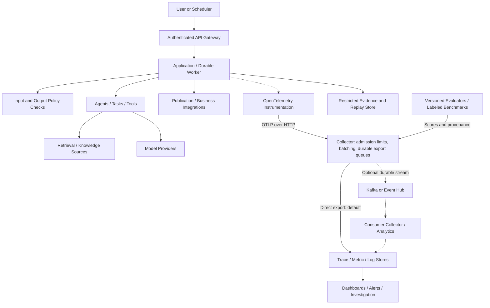

# Enterprise AI Telemetry, Monitoring, and Observability Architecture

**Version:** 1.0 · **Transport:** OTLP over HTTP · **Scope:** production AI applications, agents, and supporting services

This standard defines the signals, controls, and operating practices needed to explain an AI system's behavior, detect failures, assess quality, and account for consumption. It is independent of cloud and observability vendor. OpenTelemetry is the instrumentation and transport foundation. Kafka or Event Hub is optional.

“Must” identifies the production baseline. “Should” identifies a recommended default that teams may adapt with a documented reason. Each service must publish a coverage manifest identifying implemented, externally supplied, unavailable, and not-applicable measurements. Telemetry coverage is not a claim that a model is safe or correct.

## 1. Outcomes and architectural pillars

| Pillar | Required operational questions |
|---|---|
| System health and performance | Is the service available? Where is time spent? Are requests, jobs, memory, storage, or dependencies failing? |
| Contextual tracing | Which request, run, attempt, task, model, retrieval, policy decision, and publication produced this outcome? |
| Data and model quality | What was actually evaluated, by which evaluator and dataset version? What changed relative to a comparable baseline? |
| Business and financial accountability | What was delivered? What did it consume and approximately cost? Which organizational unit owns the work? |
| Telemetry reliability | Are signals arriving on time? Is anything buffered, rejected, sampled, or lost? |

## 2. Reference architecture

Collectors provide a common control point for authentication, resource metadata, data handling, routing, buffering, and backend choice. They do not replace application instrumentation. The evidence store is separate from routine trace and log storage because its contents have different access and retention requirements.

**Transport contract:** use OTLP over HTTP with `/v1/traces`, `/v1/metrics`, and `/v1/logs`. Protobuf and OTLP JSON are both valid HTTP encodings. This project's SDK uses HTTP/protobuf for traces and metrics; its durable log exporter uses HTTP/JSON. Production network boundaries must use TLS and authenticated ingestion. Plain HTTP is limited to loopback or explicitly approved private networks. [OTLP specification](https://opentelemetry.io/docs/specs/otlp/)

## 3. Trace lifecycle and correlation

1. The gateway propagates a valid W3C `traceparent` and, where appropriate, `tracestate`. Do not place credentials or personal data in baggage.
2. The service creates a server span and returns `X-Trace-ID` plus trace context in response headers, including handled error responses.
3. When accepting background work, persist the originating trace context with the durable job, its stable run ID, and attempt number.
4. A delayed job or retry creates a new execution trace linked to its originating request. Short synchronous operations remain child spans. A run ID connects the entire business lifecycle across all traces.
5. Trace context loading, source retrieval, input policy checks, task/agent execution, model inference, output validation, approval, artwork, publication, reconciliation, and feedback collection.
6. Attach safe error classification and outcome attributes. Explicitly mark failures caught by application code; an exception-free function can still return a failed publication.
7. Correlate operational events with the active trace/span IDs. Preserve run and execution IDs even when detailed traces are sampled out.

Span names and metric dimensions must use stable operation or route names. URLs, run IDs, publication IDs, user identifiers, and prompt text must not become metric dimensions. Attach identifiers to traces/logs instead.

Every trace must carry service name, release version, deployment environment, and owning department. Every AI run should record prompt/template version, policy version, model configuration, source snapshot hash, and pricing version where cost is calculated. A shared API key does not establish individual user identity; gateway-authenticated pseudonymous identity is required for reliable user-level attribution.

## 4. Required signal coverage

| Component | Traces and events | Metrics and outcome evidence |
|---|---|---|
| API gateway/application | Request, normalized route, status, trace context | Request rate, latency distribution, error ratio, availability |
| Scheduler/worker | Job accepted, claimed, attempt, completion, retry, expiry | Queue depth/wait, worker readiness, heartbeat, run duration/failures |
| Context/retrieval | Source access, reference loading, source snapshot version | Retrieved count, source age, dependency failure count; relevance/MRR only with an evaluator |
| Policy/guardrails | Policy name/version, stage, pass/block outcome | Decision rates; separately measured security/quality outcomes |
| Crew/agent/task/tool | Execution boundaries, assigned role, dependency relationship | Duration and outcome per bounded operation |
| Model inference | Provider/model, operation, stop reason, response ID when available | Actual input/output/cache usage, latency, streaming TTFT/TPS, versioned cost estimate |
| Database/external HTTP | Transaction or client operation, dependency, safe error type | Duration, errors, connection/storage pressure |
| Publication/approval | Review, destination check, send, result, ambiguity, reconciliation | Successful delivery, failed/unknown outcomes, publication freshness |
| Feedback/evaluation | Observations, evaluator/version/dataset, missing-field status | Engagement, quality score distributions, drift under controlled comparisons |
| Runtime/telemetry pipeline | Startup, exporter status, rejection/quarantine | CPU/memory/storage, signal heartbeat, backlog size/age, export failures and queue capacity |

Do not fabricate missing measurements. TTFT and generation TPS require observed streaming tokens. A non-streaming completion's total latency is not TTFT. Distinguish missing provider usage from zero tokens. RAG MRR requires ranked retrieval and relevance labels; a source list alone cannot establish MRR. “Useful token ratio” needs a documented labeling method and denominator.

Application process metrics are not a substitute for host/container metrics. The platform team must supply actual host/container CPU, memory limits, restarts, disk and network metrics, and approved stdout collection where required.

## 5. Data and model quality

Each evaluated score must include a run ID, idempotent evaluation ID, evaluator type/version, dataset version, timestamp, and metric definition. Model-judge scores must be labeled as such; they are not ground truth. Human and benchmark evaluations must preserve their own provenance.

Supported categories include faithfulness, toxicity, context relevance, ground-truth accuracy, and retrieval MRR. Deterministic checks such as citation-source matching, blocker count, and review approvals are useful operational measurements, but must not be described as proof of factual correctness.

For semantic drift, use a fixed benchmark, comparable prompt version, and a stable embedding model. Measure cosine distance from a versioned baseline and variance over a declared window. A changed topic distribution is a confounder; unexplained distance is not proof of a silent model update. Retain enough sample count and baseline information to interpret the signal. Alert thresholds must be calibrated against known acceptable and unacceptable examples.

## 6. Cost and business controls

Use provider-reported usage wherever available. Apply an operator-maintained, versioned USD rate card keyed by exact model ID and modality. Account for cached input separately when reported. Image estimates must be keyed by model, size, and quality. Reconcile estimated usage costs with provider invoices; incomplete usage must remain visible.

Record department on resource metadata. Record authenticated pseudonymous subject on traces where an identity provider supplies it. Do not infer a user from a shared service key.

A between-call budget gate can prevent further calls once observed spending reaches a threshold or prior usage is unknown. It is not a hard spending cap: in-flight calls, retries, unreported usage, taxes, and provider pricing changes can exceed estimates. Hard limits require provider-side limits or an enforced reservation system.

Measure business delivery and engagement separately from cost. Do not label engagement as ROI without attributed revenue and a documented cost model.

## 7. Delivery reliability and sampling

Application operational events must be durably journaled before asynchronous export. Export must run independently of model execution. Use bounded batches and payload sizes, exponential backoff with jitter, server `Retry-After` handling, and explicit quarantine for permanently rejected records. Provide a reviewed requeue mechanism.

Delivery is at least once: duplicates can occur if the receiver accepts a batch before the sender records the acknowledgment. Include stable journal and event IDs for downstream deduplication across process restarts. OTLP partial acceptance must not trigger blind retries; retain the affected records for investigation when rejected IDs are unavailable.

Collectors should use bounded sending queues backed by persistent storage on critical network hops. Monitor queue occupancy, failed exports, filesystem capacity, and rejected/dropped records. HTTP acceptance by a Collector is not proof of successful backend indexing. SDK trace buffers can still lose spans before Collector acceptance during a process crash; test this boundary explicitly. [Collector resiliency guidance](https://opentelemetry.io/docs/collector/resiliency/)

Kafka or Event Hub is **optional**. Add it for cross-region isolation, longer outage buffering, independent consumers, or throughput requirements that justify the operating cost. Define partitioning, ordering needs, retention, consumer lag, duplicates, schema evolution, TLS/authentication, and recovery procedures. A queue does not eliminate loss at the producer or a full downstream disk.

Start the small-volume reference service at 100% trace sampling. Larger deployments must document sampling ratios and keep unsampled aggregate metrics and durable outcome events. Tail sampling requires complete trace routing and sufficient memory; do not promise retention of all errors if they were already discarded by head sampling.

## 8. Privacy, evidence, and retention

Routine telemetry defaults to metadata only. Do not export prompts, response bodies, source documents, tool arguments, authorization headers, URL queries, or raw exception messages. Numeric token counts are operational data and must survive credential redaction.

Store application artifacts and replay evidence in a restricted store with encryption at rest, access control, access auditing, retention and deletion procedures. Defensive secret matching is not comprehensive PII classification. Replay export must be explicit, authenticated, audited, and non-cacheable. Redacted evidence supports best-effort reproduction; nondeterministic providers and removed content prevent guaranteed exact replay.

Suggested initial retention, subject to organizational data policy: detailed traces seven days, operational logs and metrics thirty days, replay exports no more than seven days, approved business artifacts according to their business retention schedule. Pending/quarantined events need an explicit capacity and recovery policy; do not silently delete them during an outage.

## 9. Monitoring, SLOs, and response

Initial targets to validate with load and failure testing:

- 99% API availability measured as non-5xx responses; separately track dependency and business failures.
- Operational events normally visible within five seconds; alert if the oldest pending event exceeds sixty seconds for five minutes.
- Runtime metrics heartbeat within two minutes; alert on missing data as well as bad values.
- Daily publication and engagement freshness within twenty-six hours for the daily marketing profile.
- Collector queue occupancy below 80% and application storage usage below 85%.

Use latency histograms rather than averages alone. Define production latency objectives from workload requirements; long campaign generation and short API acknowledgments need different objectives. Tune workflow freshness thresholds to the actual schedule.

Provision dashboards and alert rules as code. Configure ownership and notification routing before production acceptance. Detect observability outages from an independent monitoring path; a broken exporter cannot reliably report its own failure through that same exporter.

Incident flow: isolate the trace/run; identify the failed dependency, policy, model, or publication span; inspect restricted evidence only when authorized; reproduce in a staging environment with publication and side effects disabled; roll out a versioned prompt/policy/model change; compare quality/cost/latency against baseline; verify alert recovery. Dynamic overrides require authorization, audit, expiry, and rollback. A prompt edit is not a substitute for a security control.

## 10. Ownership and acceptance

Application teams own lifecycle coverage, metric definitions, resource metadata and safe handling. Platform teams own Collector deployment, authentication, durable volumes, infrastructure signals, backups and alert delivery. Model/data teams own evaluation datasets, evaluator calibration, drift baselines and rate cards. Service owners approve SLOs, retention, access and incident response.

Production acceptance must demonstrate: correlated request and queued execution traces; actual model usage; publication and failure outcomes; no content leakage in routine telemetry; outage/restart recovery; quarantine/requeue; bounded backlog behavior; quality provenance; pricing coverage; dashboard queries; and an alert firing and resolving through the assigned notification route.

The CrewAI implementation and its deployment steps are described in `telemetry-implementation.md`. Passing offline tests establishes implementation behavior, not live ingestion, complete evaluator coverage, or production readiness.

## References

- [OpenTelemetry OTLP specification](https://opentelemetry.io/docs/specs/otlp/)
- [OpenTelemetry Python instrumentation](https://opentelemetry.io/docs/languages/python/instrumentation/)
- [OpenTelemetry Collector resiliency](https://opentelemetry.io/docs/collector/resiliency/)
- [OpenTelemetry semantic conventions](https://opentelemetry.io/docs/specs/semconv/)
- [Datadog OpenTelemetry ingestion for agent observability](https://docs.datadoghq.com/llm_observability/instrument/otel_instrumentation/)
