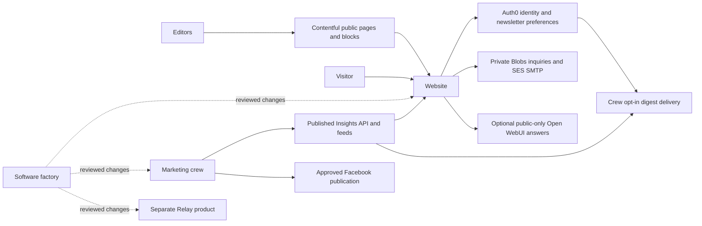

# Bun2too organization and product context

Source review: 2026-11-20, starting at commit `41465c9`. This guide reconciles repository context for the owner, Claude and Codex. It records source behavior and accepted decisions, not current cloud configuration, commercial traction or deployment health.

## Purpose and scope

Bun2too builds and operates AI applications and connected customer technology. The website leads with AI forward-deployed engineering and AI infrastructure, alongside CDP/integration, identity, analytics and consent. Fintech is supporting experimentation. Public service descriptions are not evidence of customers, certifications, revenue or guaranteed outcomes.

The owner's ambition is a large, valuable business. A valuation target is an aspiration, not a product requirement or a measured result. Future scope needs an approved spec or issue, a useful customer outcome, measurable acceptance criteria and operating-cost evidence. No growth, revenue or valuation baseline was established by this review.

## Product boundaries

| Product | Implemented responsibility | Boundary to preserve |
| --- | --- | --- |
| [Website](../../bun2too-website/docs/architecture.md) | Next.js public site, Contentful composition, Auth0 account/preferences, private inquiries and optional Open WebUI answers | Server-only credentials; separate consents; private inquiry storage; fixed public-only AI configuration |
| [Marketing crew](../../bun2too-crew-team/docs/agent-context.md) | FastAPI/CrewAI generation, deterministic Facebook publishing, public Insights projection, opt-in digest/push delivery and n8n orchestration | Reviewed evidence and exact approved copy; durable claims; one mounted SQLite store/replica; no blind replay of ambiguous sends |
| [Relay](../../bun2too-support-agent/AGENTS.md) | Tenant-configured REST/A2A support intake, case state machine, specialists and Jira/ServiceNow connectors | Policy decides actions; tenant isolation; idempotent ticket ports; Railway POC with GCP as a GA candidate |
| [Software factory](../factory.md) | Coding/review/rework automation around product PRs | Person-requested paid runs, bounded rounds, isolated commands, scanned output, exact-commit CI/review and human review of factory changes |

The website support assistant is the Open WebUI adapter. It is not already a Relay client. The crew's PO/Engineering/Tester roles produce campaign deliverables; they are not software-factory agents with shell or deployment authority. A future connection between these systems requires its own approved scope.

Contentful owns page copy/composition, not Insights articles or application authorization. CMS publication does not ingest knowledge into Open WebUI. Auth0 owns newsletter consent; the website provisions pending identities and confirms verified preferences. The crew rechecks verified, subscribed, topic-matching profiles before digest sends. Website inquiry SMTP, crew SES digest API access and Auth0 email-provider configuration are separate senders/configurations.

The packaged crew profile targets useful, provider-neutral AI/engineering education for a broad audience with technical depth. It describes the CrewAI team as a proof of concept and permits service mentions when relevant. The current contract is one article and one Facebook post per day, within the configured America/Chicago window; this is a publishing policy, not a guarantee of daily success.

## Decisions and guardrails

Read [root AGENTS.md](../../AGENTS.md), then the nearest product guide. Its Always rules apply everywhere. Accepted organization decisions live in [ADRs 0001–0005](../adr/); do not turn a contradictory older runbook into new policy.

- Work in the monorepo. Product repositories are mirrors; syncing to their `main` can start a production release. Keep one product per commit, with root-only changes separate. Agents do not push mirrors or merge outside the authorized factory loop.
- Never read or disclose environment files, tokens, state or secret-bearing provider responses. Refer to setting names and sanitized evidence. Older local troubleshooting instructions do not override root rule 7.
- Preserve consent, ownership, retention, source allowlists, review decisions, content hashes, destination checks, quotas and publication windows. A prompt is not an authorization boundary.
- Unknown usage/cost remains unknown. A between-call budget is not an account spending ceiling. Paid factory work requires a person's request; do not enable legacy roles to recover a stopped loop.
- Human production release approval and runtime editorial approval are different controls. Automatic daily publishing under the approved campaign policy does not authorize code releases or waive content review.

## Release state and unresolved alignment

| Layer | Source behavior at review | Limit |
| --- | --- | --- |
| [Root CI](../../.github/workflows/ci.yml) | Path-filtered website/crew offline checks and aggregate `ci` | Does not invoke their nested release workflows, browser packaging or live evaluations |
| Root Relay release | Main commit promoted dev → qa → prod through root workflows | `support-prod` human approval; live configuration was not inspected |
| [Website mirror workflow](../../bun2too-website/.github/workflows/ci-cd.yml) | `dev`/`qa`/`main` → GitHub `dev`/`qa`/`prod`, separate Netlify sites | Legacy branch mapping; Contentful `qa`/`qa`/`master` |
| [Crew mirror workflow](../../bun2too-crew-team/.github/workflows/deploy.yml) | Dev evaluates only; qa/main publish packages and deploy QA/production | GitHub production environment is `production`, not the website's `prod`; Railway rebuilds source, not the archived GHCR digest |
| Product model gates | Component on dev, trajectory on qa, both on main; every dimension >= 0.5 | Live evaluations currently start on mirror pushes, conflicting with newer root rule 12 |
| Product human gate | `agent-production-review` validates approval of the exact commit/report; structured scorecard optional by default | Reviewer settings are remote state; this environment name differs from root rule 9's `support-prod` |

[ADR 0003](../adr/0003-trunk-based-development.md) already records the legacy branch pipelines as a follow-up. The [draft release-alignment spec](../specs/website-crew-release-alignment.md) makes the remaining spend-trigger, approval and promotion questions reviewable. It does not authorize a CI change. Do not interpret a monorepo merge as website/crew deployment or disable existing model/human gates to make a release pass.

The vendored human-review implementations match. The evaluation cores differ only in one report instruction: the crew report asks for a scorecard unconditionally, while the validation policy makes it optional by default. Correct that generated-report wording in the release follow-up; it does not change the current approval requirement.

## Working together

Codex's current focus is the website and marketing crew. Before editing, each assistant reads `git status --short`, the approved issue/spec and nearest instructions, then identifies its intended paths. Keep concurrent edits in different files or isolated worktrees; do not reset, stash, stage or commit another assistant's work. Ownership changes should be explicit in the shared issue/PR.

Use product glossaries: [website](../../bun2too-website/GLOSSARY.md), [crew](../../bun2too-crew-team/GLOSSARY.md), [Relay](../../bun2too-support-agent/GLOSSARY.md). Maintain stable knowledge in the relevant product context; keep temporary results in dated evidence. Do not duplicate prompts, configuration inventories or full runbooks here.

A handoff should name the issue/spec, product and paths, changed behavior and rationale, exact revision, checks/outputs, unresolved risks and the next bounded action. Report implemented, fixture-tested, live-verified and deployed as separate facts. A message in one assistant's panel is not assumed to reach the other; use the shared files/issue or the owner's relay.

## Evidence and next work

The review covered root/product instructions, glossaries/ADRs, local skills, architecture/setup/security/evaluation/operations documents and dated incidents. Source cross-checks included root and mirror workflows, [CMS delivery](../../bun2too-website/src/lib/contentful.ts), [identity scopes](../../bun2too-website/src/lib/auth-config.ts), [support adapter](../../bun2too-website/src/lib/openwebui.ts)/[email claims](../../bun2too-website/src/lib/support-email.ts), [crew task dependencies](../../bun2too-crew-team/crewai_agents/app/crews.py), [published article filtering](../../bun2too-crew-team/crewai_agents/app/insights.py) and [n8n schedules](../../bun2too-crew-team/n8n/marketing-operations.json). Remote Claude artifacts, cloud settings, customer data, secrets and live providers were not inspected. Dated incident IDs and test totals remain historical evidence.

Corrected stale guidance includes implemented website AI support and inquiry email, CMS ownership, crew integration proxies and the daily n8n/final-copy review sequence. Next implementation candidates require approved tickets: release/spend alignment; explicitly mapped production approval environments; and product verification coverage appropriate to the chosen promotion design. Runtime/provider health is **inconclusive** in this documentation-only review.
