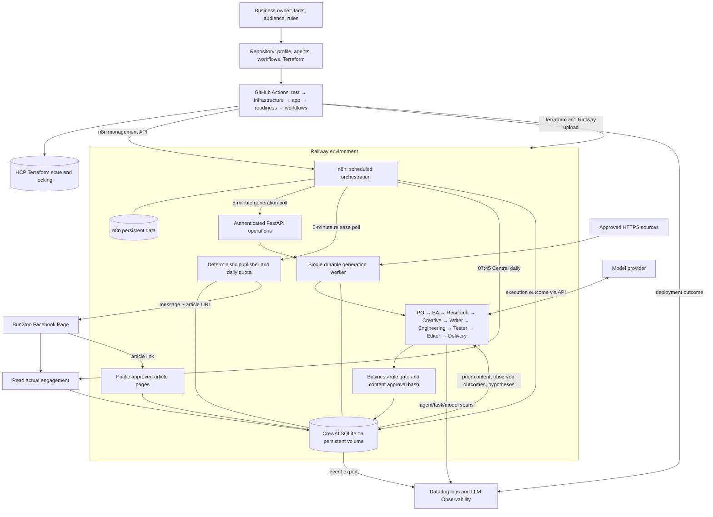

# Bun2too autonomous marketing team — MVP architecture and specification

Status: implementation in this working tree; offline verification is described below. Live deployment, workflow activation, model access, Facebook publication and Datadog ingestion are separate acceptance checks and must not be inferred from passing Terraform or mocked tests.

## 1. Product outcome and agreed operating policy

Build a small marketing department that repeatedly turns an approved business brief into useful, original content, publishes it, observes outcomes and improves the next cycle. The MVP delivers **one article and one Facebook Page post linking to it each day**. It does not spend money, buy ads, invent product facts, or change its own production code.

The owner has selected:

- Facebook destination: [Bun2too](https://www.facebook.com/bun2too). The public handle is not the numeric Page ID required by Graph API; resolve/confirm that ID using the authorized Page credentials.
- Timezone: `America/Chicago`, which handles Central Standard and Daylight Time.
- Publication window: **08:00–22:30 Central**, with a different pseudorandom target per campaign/date. Target times use five-minute slots and remain stable across restarts.
- Release policy: **automatic publishing within configured business rules**. Human review is available for blocked runs and can be selected in the profile.
- n8n UI: <https://n8n.bun2too.com/>.

Business description, intended audience, approved facts/sources, numeric Page ID and authorized Page token remain required inputs. The committed profile deliberately rejects incomplete placeholders instead of making up the business. Code supports automatic mode, but activation flags remain off until these inputs are configured. This is a configuration requirement, not a new request to approve automatic posting.

### Scope and limits

The first version operates one campaign per service instance, one configured Page, one original text article plus a text/link post. It collects available reactions, comments and shares; it does not claim to measure sales, conversions, reach, impressions or causal lift. Creative produces design briefs, not rendered media. Engineering produces implementation specifications, not autonomously executed code. The agents use fetched, operator-approved sources, not unrestricted web browsing.

## 2. End-to-end architecture



A standalone editable diagram is [marketing-architecture.mmd](marketing-architecture.mmd).

### Runtime placement and responsibility

| Component | Runs where | What it owns |
| --- | --- | --- |
| Nine CrewAI roles | Inside **one** Railway `crewai-microservice` Python container | Sequential reasoning tasks and structured deliverables, created for each campaign run |
| API | Uvicorn/FastAPI in that same container, listening on `PORT` | Authentication, job creation, status/review, article pages, operational endpoints |
| Generation worker | One thread under an exclusive filesystem lock in that container | Durable scheduled jobs, interrupted-generation recovery, event export |
| n8n | Railway `n8n-orchestrator`, existing public domain | Clock triggers, authenticated calls, persisted execution history, error workflow |
| Facebook publisher | Deterministic Python code in the API, not an LLM tool | Token/account selection, exact approved content, quota, send result and reconciliation |
| Article host | Public `/articles/{run_id}` on the CrewAI API | Escaped HTML from approved artifacts; private drafts are not publicly accessible |
| HCP Terraform | Remote state only; workspace execution mode Local | Infrastructure state and locks; it does not run the agents |
| GitHub runner | Deployment job | Tests, Terraform CLI, Railway upload, runtime check, n8n workflow installation |
| Existing Postgres | Railway `pipeline-postgres` | Existing infrastructure; the MVP does **not** silently migrate n8n or CrewAI databases into it |
| Datadog | External SaaS | Exported operational logs, deployment outcome and supported LLM spans |

A CrewAI cloud account is not needed for this self-hosted runtime. There is no separate agent dashboard: use `<CrewAI URL>/docs`, authenticated `/runs`, `/runs/{id}/work`, n8n Executions and Datadog. Agents are not nine independently deployed servers.

## 3. Code ownership and reusable configuration

| Repository location | Responsibility |
| --- | --- |
| `crewai_agents/config/marketing.json` | Packaged business profile and scheduling/business rules; edit this file for the deployed campaign |
| `config/marketing.example.json` | Example profile; not loaded automatically |
| `crewai_agents/app/agents.json` | Role definitions, goals and task instructions |
| `crewai_agents/app/crews.py` | Agent/task construction, order, model configuration and limits |
| `crewai_agents/app/models.py` | Validated campaign, agent deliverable and article/post contracts |
| `crewai_agents/app/main.py` | API, worker, source/feedback assembly, approval and orchestration |
| `crewai_agents/app/marketing.py` | Profile validation, schedule calculation, source fetch, publication gate and Facebook HTTP calls |
| `crewai_agents/app/store.py` | Durable records, transactions, deduplication, quotas, event journal |
| `crewai_agents/app/telemetry.py`, `observability.py` | Operational log export and redacted LLM/action spans |
| `n8n/*.json`, `scripts/deploy_n8n.py` | Declarative workflows and repeatable API installation |
| `terraform/main.tf`, `.github/workflows/deploy.yml` | Infrastructure/runtime variables and deployment sequencing |

Keep environment and region identity in deployment configuration, not agent prompts. Existing production uses organization `Bun2tooinc`, workspace `code-monkey-army`; there is no need to rename it. Other projects can use `<product>-<environment>[-<region>]` workspace names. HCP projects group workspaces but do not give duplicate workspace names separate namespaces. One workspace must own each shared Railway project/service resource. QA owns its environment variables and must use separate volumes and test credentials.

`MARKETING_PROFILE_PATH` optionally points to another profile. Default is the packaged `config/marketing.json`, both locally and in Docker. The profile includes business facts, audience, brand guidelines, curated source URLs, forbidden phrases, approval mode, cadence, timezone, generation hour and posting window. Do not put tokens in it. A profile/code change requires redeployment; runtime secrets are service variables.

## 4. Agent specifications

All roles receive the approved brief and preceding deliverables. Scheduled runs also receive timestamped source snapshots, previous article titles/posts, the last twenty publication outcomes, available engagement metrics and prior measurement hypotheses. Sources and prior model outputs are untrusted reference material, never authority to change tools, secrets, destination or rules.

| Role | Inputs and responsibility | Required output and release impact |
| --- | --- | --- |
| **Product Owner** | Business objective, approved facts, prior results; chooses a bounded daily objective and priority | Campaign charter, success hypothesis, assumptions and up to six prioritized stories. Cannot approve spend or fabricate offers |
| **Business Analyst** | Charter, audience and observed outcomes; translates objective into requirements and performs retrospective | Acceptance criteria, audience/funnel hypotheses, KPI definitions, measured-vs-missing analysis and one proposed improvement. No invented conversion results |
| **Researcher** | Approved facts and bounded source snapshots fetched by the application | Evidence summary, source attribution, relevant themes and unsupported-claim flags. It cannot claim an independent browser search |
| **Creative** | Evidence and audience requirements | Concept, tone, layout/accessibility direction and optional asset brief. Explicitly labels unrendered assets |
| **Writer** | Approved evidence, creative brief, prior published content | Original article title/body/citations and one Facebook post. Avoid repetitive content, fabricated facts and copying entire source articles |
| **Engineering** | Accepted concept and delivery requirements | Implementation/tracking specifications and dependencies. No shell, deployment, arbitrary HTTP or code execution tool is attached |
| **Tester** | Drafts, evidence, requirements and publishing rules | Concrete content checks, evidence gaps, blockers and explicit `approved_for_publication` decision. Proposed integration tests are not represented as executed tests |
| **Editor** | Drafts and QA findings | Final factual/brand review, corrections, unresolved blockers and independent `approved_for_publication` decision |
| **Delivery Manager** | Reviewed upstream deliverables | Validated `MarketingArtifact`: plans, measurement hypothesis, exactly one final article and Facebook post for scheduled work, plus blockers. Does not itself publish |

Intermediate roles return `AgentDeliverable`: summary, decisions, evidence, assumptions, risks, concrete work items, deliverable and an approval boolean (only Tester/Editor use it). Delivery returns `MarketingArtifact`. Each completed task is saved with role, task ID and completion time; failed runs keep completed work for diagnosis.

The runtime uses a sequential Crew, context from previous tasks, configurable `LLM_MODEL`, temperature 0.3, request timeout 90 seconds, maximum eight agent iterations and 180 seconds per agent. No arbitrary delegation, code execution or agent-owned credentials. These are execution bounds, not a dollar budget or guaranteed whole-run timeout. Use model-provider spending limits and monitor costs. Provider failures produce an explicit failed run without exporting raw secret-bearing exceptions.

### Approval semantics

Automatic approval requires both runtime `AUTO_APPROVAL_ENABLED=true` and profile `approval_mode=automatic`, no artifact blockers, explicit Tester and Editor approval, one Facebook post, one article, allowed retrieved citations, the content-size limit and no configured forbidden phrase or arbitrary URL in prose. The publisher adds the approved article URL itself. An approved artifact receives a SHA-256 hash; later publication verifies the exact same content.

These deterministic checks complement LLM content review; they cannot mathematically prove factual accuracy or compliance with every prose rule. Incomplete evidence or a rejected review holds the run at `awaiting_review`. An operator may inspect/edit through `/runs/{id}/approve`; edits still pass publishing checks. If the model review was rejected, regenerate with corrected evidence so Tester and Editor reassess it. Agents cannot override the configured policy. Human mode never auto-approves.

## 5. Daily control flow and n8n workflows

The workflow `[production] Marketing daily operations` has three independent scheduled branches. `[qa]` uses the same source with environment-specific credentials and flags.

1. **07:45 Central: metrics.** `POST /automation/metrics` reads engagement for the last twenty published records. Missing fields stay missing, never converted into invented zeroes. A failed read preserves the last observation with its timestamp.
2. **Every five minutes: generation tick.** `POST /automation/tick` calculates the daily campaign/date key after 08:00. One transaction inserts a queued run and its chosen publication window, or returns the existing run. No long LLM request runs inside the n8n HTTP call.
3. **Worker: generate.** The worker claims the durable job, fetches configured sources, assembles business facts plus feedback, runs all nine roles, saves the artifact and evaluates approval policy. The daily article can be prepared before its target publication time.
4. **Every five minutes: publish poll.** `POST /automation/publish` considers scheduled approved runs. Before their randomized target they remain queued for release. Within the window the publisher claims the send atomically and posts the message plus article link to the configured Page.
5. **Result and learning.** Save the returned Facebook post ID, expose the approved article, journal the result and export logs. The next morning's observations feed BA/PO/Creative/Writer; Delivery records one new testable hypothesis.

The daily window ends at 22:30. No catch-up posting outside it: overdue approved content becomes `expired`. If generation misses the window, the next day's campaign is separate. Exact publication minute is best effort, bounded by polling, generation and external service availability. Default cadence is 1,440 minutes (local daily); other supported cadence values use fixed UTC buckets and the same local release window/quota. Increasing cadence does not increase the daily posting limit automatically.

`00-error-handler.json` records n8n failures via `POST /automation/events`. Successful branches also record execution IDs. The error workflow is linked through `settings.errorWorkflow`; it is not a separately scheduled workflow. If CrewAI is unavailable, n8n retains the failed execution even though its callback cannot reach the event exporter.

`deploy_n8n.py` lists workflows with pagination, identifies each managed workflow by environment-specific name, rejects duplicate names, deactivates an active managed workflow before updating it, creates missing workflows and optionally activates the schedule. Unrelated workflows are not changed. Renaming a managed workflow can create another copy on a later deployment, so keep managed names stable. If an update fails after deactivation, repair/redeploy before expecting scheduled work; inspect the API error and n8n UI.

## 6. State, failure handling and persistence

```mermaid
stateDiagram-v2
  [*] --> queued: unique campaign/date
  queued --> running: worker claim
  running --> awaiting_review: artifact saved
  running --> failed: generation error
  running --> queued: interrupted; one bounded restart retry
  awaiting_review --> approved: policy or operator approval
  approved --> publishing: window + hash + quota + atomic claim
  approved --> expired: window closed
  publishing --> published: verified Graph response ID
  publishing --> publication_failed: definite HTTP 4xx
  publishing --> publication_unknown: ambiguous network/server response
  publication_unknown --> published: operator supplies post ID; API verifies content
```



The store is SQLite on `/data/runs.sqlite3`, with tables for runs, schedule slots, social posts, events and existing Atlassian publications. The filesystem lock elects one generation worker for this mounted directory; transactional claims prevent concurrent request duplication. On worker restart, an interrupted scheduled generation is retried once, then marked failed. Legacy manual `/campaigns` background jobs and synchronous `/generate-post` retain their existing behavior; they are not the durable scheduled queue.

Publication claims commit **before** HTTP POST. A process crash can leave `sending`, while an ambiguous timeout produces `unknown`. Neither is retried automatically. Facebook's feed API does not become idempotent just because the application has a run ID. This design favors avoiding duplicate public posts over guaranteed delivery. Inspect the Page, then use authenticated `POST /social-publications/{id}/reconcile` with the observed remote ID and reviewer; it verifies Page prefix and exact message before marking published. If there is no post, leave the ambiguous record for audit and use a later approved campaign; do not delete its claim to force a resend.

The daily limit counts attempted publications, including failed/unknown attempts. It is per configured Page and Central calendar date, persisted locally. It does not account for posts made manually or by another tool. A separate database per replica would break global quotas: **run one CrewAI replica with one volume** in this MVP. Scale-out requires shared transactional storage and a dedicated queue first.

### n8n persistence and existing-instance migration

n8n normally stores SQLite, credentials, owner configuration and other files under `/home/node/.n8n`. An image deployment alone does not preserve this directory. Terraform now supports the `n8n-data` volume at that path, behind `n8n_volume_ready`. Default is false to avoid covering the existing unmounted database with an empty volume.

For the existing configured instance:

1. Pause workflow execution and retain the current deployment. Determine whether n8n currently uses SQLite or Postgres and whether a volume is already attached. Do not assume the separate Postgres service means n8n uses it.
2. Take a consistent database backup and preserve the **entire n8n data directory**, including its current encryption configuration. Export workflows/credentials as an additional recovery aid. Verify restoration in an isolated instance before replacing the original data location. Do not copy a live SQLite file without its consistency guarantees.
3. Preserve the exact existing encryption key. A newly generated `N8N_ENCRYPTION_KEY` cannot decrypt old credentials. Never display backups or decrypted credentials in CI logs or commit them.
4. Attach/adopt the volume and restore the verified backup to its mount with ownership appropriate for n8n's `node` user. Enable `n8n_volume_ready` only as part of that controlled cutover; plan must not delete/recreate services. Import an already-existing volume/service configuration rather than creating a second one.
5. Restart, verify owner login, credentials and workflow IDs, then repeat a restart and confirm the same records remain. Re-enable schedules only after that check.

The backup/restore method depends on the live storage mode and Railway access; it has not been executed by this code change. The provider's known volume read-after-create issue can report a failure after a volume already exists: inspect/refresh the existing volume, never blindly delete data and recreate it. See [deployment troubleshooting](deployment.md).

Keep regular backups of both CrewAI and n8n data. A mounted volume is persistence, not a backup. n8n execution retention should be bounded; CrewAI history currently has no automated archival, so monitor volume usage. A future version can move both databases to separate schemas/databases in Postgres, retaining the stable n8n encryption key and migrating existing data explicitly.

## 7. Observability that actually exports data

| Signal | Producer and transport | How to inspect |
| --- | --- | --- |
| Campaign and publication events | SQLite event journal → `telemetry.py` → Datadog Logs HTTPS intake | Logs query `service:bun2too-marketing-api env:production`, then `@run_id:<id>` |
| n8n completion/failure | Workflow callback → same journal/exporter | `@kind:n8n_execution_failed` or `@kind:n8n_execution_completed`; execution ID is in `run_id` prefixed `n8n:` |
| Agent/task/model spans | `start.py` starts `ddtrace-run`; CrewAI integration and custom workflow span | LLM Observability app `bun2too-marketing-crew-team`, environment and run/session ID |
| Deployment outcome | Always-run GitHub step → `report_deployment.py` → Datadog Logs | `service:bun2too-deployment`, `@github_run_id` and `@git_sha` |
| Detailed command output | Existing deployment command wrapper and Railway process logs | GitHub Actions logs/summary; Railway deployment and runtime logs |

Set `DD_LOGS_ENABLED=true`, `DD_API_KEY`, `DD_SITE`, `DD_SERVICE`, `DD_ENV` for application logs. Set `DD_LLMOBS_ENABLED=1`, `DD_LLMOBS_AGENTLESS_ENABLED=1` for LLM export. Default site is US5; change it to match the Datadog account. CI requires its own `DD_API_KEY` secret; a Railway secret is not automatically a GitHub secret.

The log exporter sends bounded batches and marks events exported only after a successful HTTP response. It retries failed batches on subsequent worker loops. Delivery is at least once: a crash after intake acceptance can duplicate an event; `event_id` and `run_id` support investigation. Export runs between generation batches, so a busy long generation can delay logs. It sends operational metadata, not prompts or raw API bodies. LLM Observability can contain campaign prompts/outputs; configured-secret redaction is defensive and cannot guarantee removal of arbitrary sensitive prose. Disable prompt tracing if campaign material must remain local.

This implements application events and a deployment outcome, not a Datadog infrastructure Agent or streaming of every GitHub/Railway stdout line. Host CPU/memory and full container-log shipping require a separate supported infrastructure/log integration. No dashboard or monitor is provisioned automatically. Recommended monitors after confirming ingestion: run/publication failures, no successful publication for 26 hours, missing workflow heartbeat, stale engagement observations and low disk space from a host metric source.

## 8. API contract and operator access

Except `/health`, `/docs`/OpenAPI and published article pages, business endpoints require `Authorization: Bearer <MARKETING_API_KEY>`. Treat this shared key as privileged: it grants generation, inspection, approval and configured publication operations. It is not a per-person authentication system.

| Method/path | Contract |
| --- | --- |
| `GET /health` | Process liveness only; does not assert model/platform credentials work |
| `GET /ready` | Storage, worker readiness, model configured, enabled flags and missing configuration names; no secret values |
| `POST /automation/tick` | Durable scheduled run creation; responds quickly with run ID/created/status or not due |
| `POST /automation/publish` | Release eligible scheduled artifacts; returns per-run published/unknown/failed/blocked records |
| `POST /automation/metrics` | Refresh available Facebook engagement observations |
| `GET /automation/status` | Latest runs and publication records |
| `POST /automation/events` | Record n8n execution ID, workflow name and status |
| `GET /runs/{id}` and `/runs/{id}/work` | Saved brief, tasks, artifact, approval, event trail and existing corporate publications |
| `POST /runs/{id}/approve` | Approve saved or edited artifact with reviewer label and content hash |
| `POST /social-publications/{id}/reconcile` | Verify a known Facebook post after an ambiguous send; never issues another feed POST |
| `GET /articles/{id}` | Escaped HTML for an approved article once publication has been attempted |

The legacy `/campaigns`, `/generate-post`, and `/runs/{id}/dispatch` interfaces remain. `/dispatch` uses the old separately configured n8n webhook; it is **not** the daily workflow and should not also publish the same scheduled campaign. Scheduled campaigns intentionally do not auto-publish Jira/Confluence work on every daily cycle. Existing manual campaign integration remains documented in [agent operations](agent-operations.md).

## 9. CI/CD and activation configuration

The deployment job now executes application and infrastructure-script tests before external preflight; initializes/validates Terraform; imports state and plans when explicitly in import mode, or prepares state and applies in deploy mode; verifies Postgres; uploads the CrewAI app; optionally checks authenticated runtime readiness and installs n8n workflows; and reports deployment outcome to Datadog. All command wrappers retain timestamps, exit codes and duration.

Application/secret configuration is explicit. `MARKETING_RUNTIME_CONFIG` and `N8N_RUNTIME_CONFIG` are GitHub environment secrets containing JSON string maps that Terraform writes into the selected Railway service/environment. Sensitive values are still stored in HCP Terraform state. Protect state access, keep maps complete across deployments, and never put plaintext secrets into committed tfvars. Existing variables being adopted into Terraform should be imported/reviewed using the provider format described in the deployment guide.

| Setting | Location/use |
| --- | --- |
| `MARKETING_RUNTIME_CONFIG` | GitHub environment secret: desired CrewAI runtime map, including model/provider credentials, MARKETING_API_KEY, FACEBOOK_* and DD_* |
| `N8N_RUNTIME_CONFIG` | GitHub environment secret: existing encryption key, public URL/proxy/timezone and optional retention config |
| `N8N_SERVICE_ID` | GitHub environment variable for runtime variable targeting |
| `N8N_VOLUME_READY` | GitHub variable `true` only after the existing-data migration is prepared/completed; keep true after adoption |
| `MARKETING_DEPLOY_ENABLED` | GitHub variable `true` enables runtime check and n8n installation steps |
| `CREWAI_BASE_URL` | GitHub variable: public HTTPS API origin, no trailing API path |
| `N8N_BASE_URL` | GitHub variable: `https://n8n.bun2too.com` |
| `N8N_API_KEY` | GitHub secret: n8n management key authorized to list/create/update/activate these workflows |
| `N8N_MARKETING_CREDENTIAL_ID` | GitHub variable: ID of n8n Header Auth credential with header `Authorization`, value `Bearer <MARKETING_API_KEY>` |
| `MARKETING_API_KEY` | GitHub secret for readiness; must equal the CrewAI runtime key and n8n credential value |
| `N8N_ACTIVATE_WORKFLOWS` | GitHub variable: `true` to activate the installed schedule, false to leave it inactive |
| `DD_API_KEY`, `DD_SITE` | GitHub secret/variable for deployment logs; also separately in the CrewAI runtime map |

For automatic production operations, the CrewAI runtime must include `MARKETING_AUTOMATION_ENABLED=true`, `AUTO_APPROVAL_ENABLED=true`, `PUBLISHING_ENABLED=true`, `WORKER_ENABLED=true`, a model and its provider key, public article URL and Facebook version/Page token/ID. Keep QA publishing disabled or point QA exclusively at an authorized test Page. Token expiration and revocation require operator renewal; the code does not manufacture long-lived authorization.

Set the n8n public variables to `WEBHOOK_URL=https://n8n.bun2too.com/`, `N8N_EDITOR_BASE_URL=https://n8n.bun2too.com`, `N8N_PROXY_HOPS=1`, `GENERIC_TIMEZONE=America/Chicago`, `TZ=America/Chicago`, alongside the **existing** encryption key. These settings do not automatically migrate its database.

To expose CrewAI, use Railway service **Settings → Networking → Generate Domain**, targeting the port the app actually listens on (`PORT`, default 8000). Use that HTTPS URL for both `CREWAI_BASE_URL` and runtime `PUBLIC_API_BASE_URL`. Railway-provided domains/TLS do not require purchasing another domain; runtime/model/Datadog costs remain subject to their plans. This workflow installer currently uses the public HTTPS API URL; private-network transport is a possible later configuration extension, while article links must stay public.

## 10. Local verification and live acceptance

Run the full offline checks before committing:

```sh
.venv/bin/python scripts/verify_marketing.py --terraform
```

This requires installed Python dependencies and initialized Terraform providers. The script disables live telemetry during tests, runs mocked application/deployment tests, validates workflow JSON, and optionally runs Terraform validate plus mock-provider plans. It never applies infrastructure or publishes. See [marketing operations runbook](marketing-operations.md) for exact local/live commands.

Required live evidence before calling the MVP operational:

1. CrewAI `/ready` reports storage/worker/model configuration ready; one genuine model-backed campaign completes all roles with saved outputs.
2. The two managed workflows exist in n8n, the daily workflow is active and its Header Auth credential works. Execution history survives restart.
3. One scheduled run is deduplicated across repeated ticks/restarts, receives valid content reviews and waits until its persisted target time.
4. The Page feed returns a real post ID; the visible post matches the approved message and links to a reachable article. A repeated publish poll sends nothing again.
5. Engagement collection records actual fields and timestamps; a subsequent brief includes those observations and a new measured hypothesis.
6. Datadog contains the matching run/task logs, LLM session (if enabled), n8n execution outcome and deployment log.
7. Both data stores survive a controlled restart, and their backups have been restored in an isolated environment.

Offline tests verify mechanics with simulated external responses. They do not validate content quality from the chosen live model, the installed n8n version's behavior, Meta permissions, expired tokens, Datadog account entitlements or actual persistence of an unconfigured volume. Outstanding live inputs are listed in the runbook; do not bypass them by treating a successful infrastructure apply as an application acceptance test.

## 11. Evolution after the MVP

Next priorities are shared Postgres/job workers for scale and leases, verified source search connectors, an operator review UI with identities, explicit article/content versioning, experiment assignment and conversion attribution, images/accessibility checks, multi-channel adapters and multi-business isolation. Add per-tenant destination credentials, quotas and storage boundaries before serving multiple businesses from one instance. Add regional data ownership before introducing multiple regional deployers. Changes to agent code/tools and business rules remain reviewed repository changes deployed through CI; retrospective recommendations never self-modify production.

### Reference contracts

- [Railway public domains](https://docs.railway.com/networking/domains/working-with-domains)
- [n8n data directory and Docker persistence](https://docs.n8n.io/deploy/host-n8n/install-options/install-with-docker.md)
- [Meta Pages publishing](https://developers.facebook.com/docs/pages-api/posts/) and [Meta-owned Facebook API collection](https://www.postman.com/meta/facebook/documentation/r56bjfd/facebook-api)
- [Datadog Logs intake](https://docs.datadoghq.com/api/latest/logs/) and [CrewAI LLM Observability](https://docs.datadoghq.com/llm_observability/guide/crewai_guide/)
